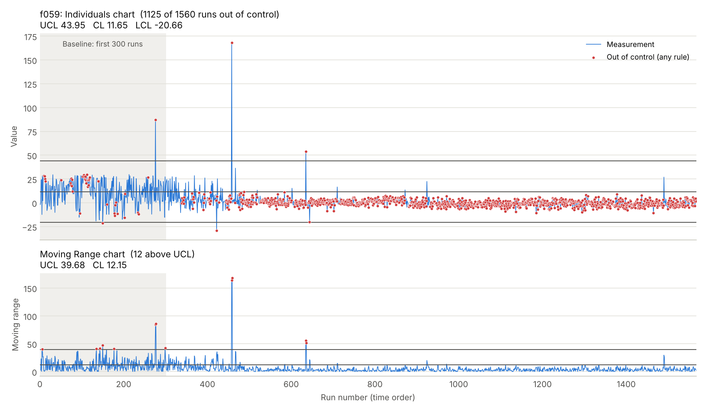

# SPC and Process Capability Analysis on Semiconductor Manufacturing Data

Statistical process control (I-MR charts with Western Electric rules) and
process capability (Cp/Cpk) on the UCI SECOM dataset, with tidy exports and a
build guide for a Power BI dashboard.

**Main result:** the features that look most associated with failing runs over
the whole dataset are mostly picking up a change in the process over time.
Control charts exposed a sustained level shift after the first few hundred
runs. Once the runs are split into two stages, only one group of
near-duplicate features remains significantly associated with failure, and
only in the first stage.



## Problem

A fab collects hundreds of sensor readings per production run. Which of them
relate to failing runs, are those signals stable over time, and how could an
engineer monitor them? This project works through that question with standard
SPC tools on public data.

## Dataset

[UCI SECOM](https://archive.ics.uci.edu/dataset/179/secom) (McCann and
Johnston, donated 2008): sensor measurements from a semiconductor
manufacturing process, with a pass/fail result and a timestamp per run. The
process step and the meaning of each sensor are not disclosed.

Facts checked from the files:

| | |
|---|---|
| Runs | 1,567, from 19 Jul 2008 to 17 Oct 2008 |
| Features | 590 numeric columns, anonymised (named `f000` to `f589` by position) |
| Labels | 1,463 pass (`-1`), 104 fail (`1`), a 6.6% fail rate |
| Missing values | 4.5% of all cells; only 52 features are complete |
| Join | The two raw files share no key; rows match by position |
| Timestamps | Day-first format; 33 runs share a timestamp with an earlier run |

## Method

1. **Load and clean** (`src/load_clean.py`). Join sensors and labels by row
   position, sort by time, and drop 116 constant features and 32 features
   that are more than 40% missing. No feature has between 18% and 45%
   missing, so any threshold in that gap gives the same result. 442 features
   remain. Missing values are never filled in.
2. **Rank features** (`src/feature_ranking.py`). A Mann-Whitney U test per
   feature compares pass and fail runs, with a Benjamini-Hochberg correction
   at a 5% false discovery rate.
3. **Control charts** (`src/spc_rules.py`, `src/control_charts.py`).
   Individuals and Moving Range charts for the top 5 features, skipping
   near-duplicates (rank correlation above 0.9). Limits come from a baseline
   period and are then frozen. Four Western Electric rules are checked: one
   point beyond 3 sigma; 2 of 3 beyond 2 sigma; 4 of 5 beyond 1 sigma; 8 in a
   row on one side.
4. **Two stages** (`src/stages.py`). The first charts showed a level shift,
   so runs are split at run 501 and each stage gets limits from its own
   first 300 runs.
5. **Time-effect check** (`src/stage_comparison.py`). The ranking test is
   repeated inside each stage.
6. **Capability** (`src/capability.py`). Cp and Cpk (short-term sigma) and Pp
   and Ppk (overall sigma) against assumed spec limits.
7. **Power BI export** (`src/export_powerbi.py`) and build guide
   (`reports/powerbi_guide.md`).

## Key findings

**Ranking over all runs.** 82 of 442 features have a raw p-value below 0.05,
where about 22 would be expected by chance. 17 remain significant after
correction. The strongest is `f059`, but it is a weak separator: a failing run
reads higher than a passing run 69% of the time.

**The process shifted.** In the first version, with one set of limits from
the first 300 runs, 63% to 91% of later runs were flagged on four of the five
charted features, mostly by the "8 in a row" rule. That pattern means a
sustained change in level, not isolated spikes. The fail rate changed over the same period: 11.8% in runs
1 to 500 against 4.2% in runs 501 to 1567.

**Most of the ranking is a time effect.** Tested inside each stage:

| | Stage 1 (runs 1-500) | Stage 2 (runs 501-1567) |
|---|---|---|
| Failing runs | 59 of 500 | 45 of 1,067 |
| Features significant after correction | 3 of 436 | 0 of 442 |

The three stage 1 features (`f477`, `f205`, `f341`) are near-duplicates of
each other, so they are one signal. `f059` is not significant in either
stage (adjusted p about 0.16). Part of this is lower statistical power with
fewer failing runs per stage, but the effect sizes shrink as well.

**No charted feature is in statistical control, even with staged limits.**
Share of runs flagged after each stage's baseline:

| Feature | Stage 1 | Stage 2 |
|---|---|---|
| f059 | 35% | 13% |
| f103 | 69% | 25% |
| f510 | 43% | 24% |
| f477 | 5% | 51% |
| f129 | 32% | 65% |

For reference, a simulated stable process is flagged on about 1.6% of runs
with the same method (see the notebook).

**Capability (assumed spec limits).** `f059` moves from Cpk 0.71 in stage 1
to 2.64 in stage 2, because its run-to-run noise dropped sharply after the
shift. `f477` in stage 1 has Cpk 2.23 but Ppk 0.60: small short-term noise,
with occasional large spikes. These numbers compare features and stages; they
are not real capability.

A lead that is **not tested**: in stage 2, runs flagged on `f059` failed at
8.3% (10 of 120) against 3.7% (35 of 940) for unflagged runs.

## Limitations

- **Anonymised features.** Nothing here says what any sensor measures, and
  no feature should be read as a specific physical quantity.
- **Assumed spec limits.** SECOM publishes none. The limits used are the
  passing-run mean plus and minus 3 sigma, a configurable assumption
  (`SPEC_SIGMA_MULTIPLIER`). Cp and Cpk depend directly on that choice.
- **Correlation is not causation.** A feature associated with failures may
  simply have changed at the same time as something else.
- **The stage split is a judgement.** Run 501 was chosen by eye, with
  hindsight, as the point where the shift had settled. It is not a
  documented process event, and the shift itself is gradual.
- **The baselines are not clean.** Stage 1's baseline is the period with the
  highest fail rate, so it is not a known-good reference period.
- **Non-normal data.** Several top features are heavily skewed or jump
  between levels. I-MR charts and capability indices assume roughly normal,
  stable data, so false alarms are more likely and the indices are rough.
- **One pass/fail label per run.** The label is an end-of-line result; the
  data cannot say which step caused a failure.

## How to run

Tested with Python 3.13 and the package versions pinned in
`requirements.txt`.

```bash
python3 -m venv .venv
```

```bash
source .venv/bin/activate
```

```bash
pip install -r requirements.txt
```

```bash
python src/run_all.py
```

```bash
pytest
```

On Windows, activate with `.venv\Scripts\activate` instead.

`run_all.py` downloads the data on first use. If the download is blocked,
unzip `secom.zip` from the UCI page into `data/raw/` and run it again. To
view the notebook, run `jupyter notebook notebooks/01_exploration.ipynb`.

Every analysis choice (thresholds, baseline length, stage split, assumed
spec multiplier) is a named setting in `src/config.py`.

## Repository layout

```
data/raw/           raw download (not committed)
data/processed/     CSV tables for Power BI
src/                analysis scripts; config.py holds every setting
tests/              36 unit tests on small hand-worked examples
notebooks/          short exploration notebook with charts
reports/            Power BI guide, result tables, figures/
```

## Power BI

`reports/powerbi_guide.md` explains how to build the dashboard from the four
tables in `data/processed/`: the data model, DAX measures, four pages
(pass-rate trend, top failing features, control chart per feature, capability
table), and check values to confirm the result. The guide has not been tested
in Power BI Desktop.

## AI-assisted development

This project was built with AI-assisted development, using Claude Code as a
pair programmer and tutor. The code was written in small steps, each
explained and reviewed before moving on, and the analysis decisions
(thresholds, correction method, baseline, staging, assumed spec limits) were
made by the author after weighing the options.
